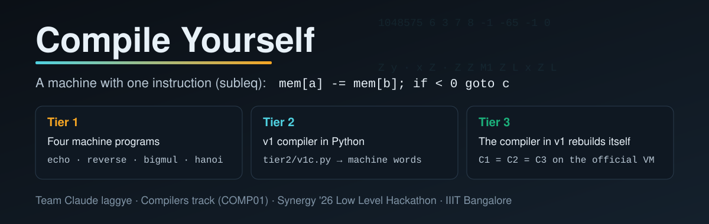
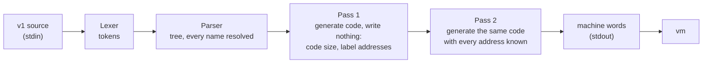
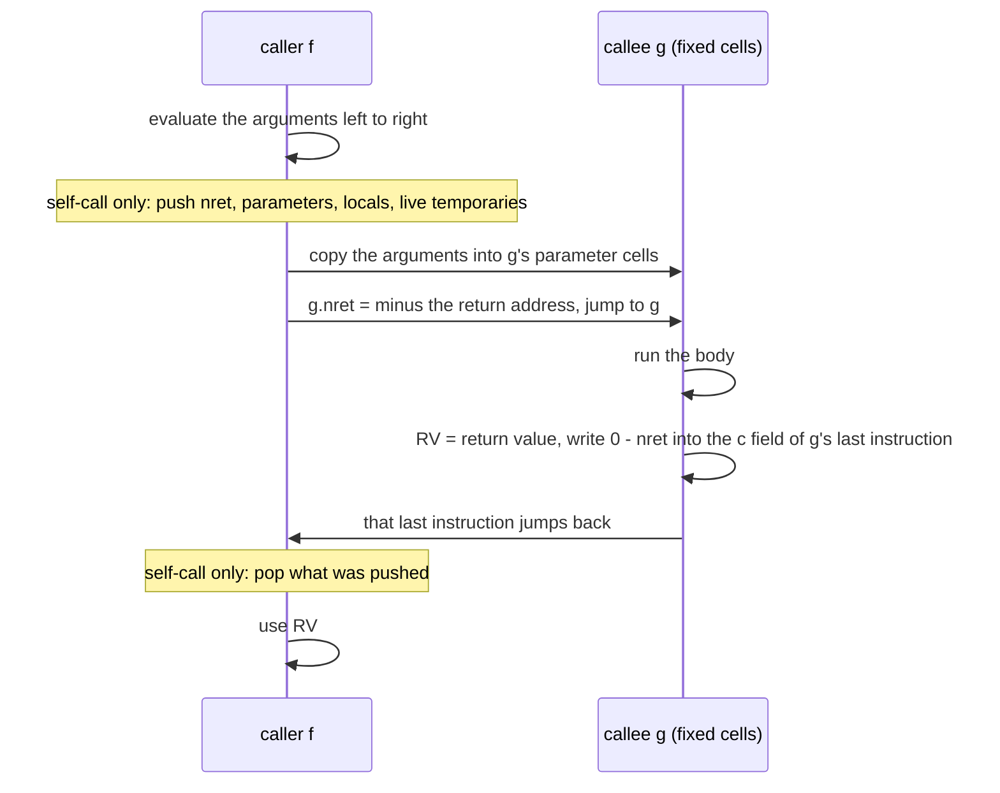
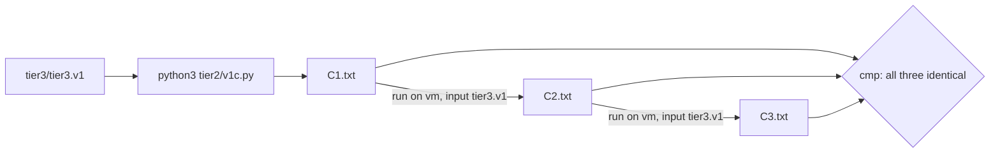

<div align="center">



<br>
<br>

[](https://www.python.org/)
[](tools/vm.c)
[](#quick-start)
<br>
[](#the-machine)
[](#status)
[](#status)
[](#tier-3-the-bootstrap)

**[Repository](https://github.com/Paradox-73/Compile_Yourself)** &nbsp;|&nbsp; [Compiler](tier2/v1c.py) &nbsp;|&nbsp; [Build and run](tier2/BUILD.md) &nbsp;|&nbsp; [Design log](docs/design_log.md)

**Demo video:** `<YOUTUBE_LINK>`

</div>

Team Claude laggye's entry for problem COMP01, "Compile Yourself", in the Compilers track of the Synergy '26 Low Level Hackathon at IIIT Bangalore. The target machine has one instruction: subtract, and jump if the result is negative. It has no add, move, pointers or calls. We build those from that one instruction, write a compiler for the small language v1, and then rewrite that compiler in v1 so that it compiles itself.

## Contents

- [Status](#status)
- [Quick start](#quick-start)
- [What is in the repository](#what-is-in-the-repository)
- [Pre-compiled programs and executables](#pre-compiled-programs-and-executables)
- [Architecture](#architecture)
- [The machine](#the-machine)
- [Building blocks](#building-blocks)
- [Memory layout](#memory-layout)
- [Expressions and comparisons](#expressions-and-comparisons)
- [Multiplication](#multiplication)
- [Arrays and pointers](#arrays-and-pointers)
- [Function calls and recursion](#function-calls-and-recursion)
- [Tier 1 programs](#tier-1-programs)
- [Tier 3: the bootstrap](#tier-3-the-bootstrap)
- [Testing](#testing)
- [Benchmarks](#benchmarks)
- [Rule changes](#rule-changes)
- [Language choices](#language-choices)
- [Limitations](#limitations)
- [Demo](#demo)
- [Team](#team)
- [Credits](#credits)

## Status

| Tier | What it is | State |
|---|---|---|
| 1 | Four machine programs: `echo`, `reverse`, `bigmul`, `hanoi` | done, all correct on the organisers' `VM_tier1and2` |
| 2 | [`tier2/v1c.py`](tier2/v1c.py): v1 to machine code, in Python | done, every test matches the reference interpreter |
| 3 | [`tier3/tier3.v1`](tier3/tier3.v1): the same compiler written in v1 | done, C1 = C2 = C3 on the organisers' `VM_tier3` |

## Quick start

1. Get the code:

   ```
   git clone https://github.com/Paradox-73/Compile_Yourself.git
   cd Compile_Yourself
   ```

2. Build the local machine. [`tools/vm.c`](tools/vm.c) follows the machine in the brief and gives the same results as the organisers' `vm`:

   ```
   gcc -O2 -o tools/vm tools/vm.c          # Linux, macOS (clang works too), Windows with MinGW
   ```

3. Compile and run a v1 program:

   ```
   python3 tier2/v1c.py < tests/ex1.v1 > ex1.txt
   tools/vm ex1.txt < /dev/null            # prints 6
   VM_STATS=1 tools/vm ex1.txt < /dev/null # also prints the step count on stderr
   ```

`v1c.py` reads a v1 program on standard input and writes the machine program, as whitespace-separated decimal words, on standard output. It needs Python 3 and nothing else. [`tier2/BUILD.md`](tier2/BUILD.md) has the same steps in short form.

## What is in the repository

| Path | What it is | Brief item |
|---|---|---|
| [`tier1/`](tier1/) | `echo.txt`, `reverse.txt`, `bigmul.txt`, `hanoi.txt` | Tier 1 machine programs |
| [`tier1/src/`](tier1/src/) | The v1 sources the Tier 1 programs are compiled from | |
| [`tier2/v1c.py`](tier2/v1c.py) | The v1 compiler: lexer, parser, two-pass code generator | Tier 2 compiler |
| [`tier2/BUILD.md`](tier2/BUILD.md) | How to run the compiler | Tier 2 build notes |
| [`tier3/tier3.v1`](tier3/tier3.v1) | The v1 compiler written in v1 | Tier 3 |
| [`tools/vm.c`](tools/vm.c) | Local copy of the machine, for fast tests | tools |
| [`tools/v1ref.py`](tools/v1ref.py) | Reference interpreter for v1, written from the brief | tools |
| [`tools/v1gen.py`](tools/v1gen.py) | Random valid v1 program generator | tools |
| [`tools/run_tests.py`](tools/run_tests.py) | Test runner: compile, run, compare with the reference | tools |
| [`tools/stress.py`](tools/stress.py) | Worst-case programs through both compilers | tools |
| [`tests/`](tests/) | v1 test programs with inputs and expected outputs | test suite |
| [`docs/design_log.md`](docs/design_log.md) | What we tried, what failed, and why | one-page design log |

## Pre-compiled programs and executables

- **Tier 1 programs:** [`tier1/*.txt`](tier1/) are finished machine programs. Run them directly, for example `printf '3\n' | tools/vm tier1/hanoi.txt`.
- **C1, the compiled Tier 3 compiler:** not committed, because one command builds it: `python3 tier2/v1c.py < tier3/tier3.v1 > C1.txt` (64,518 words).
- **Local VM:** `tools/vm.exe` and `tools/vm` are the same Windows x86-64 build of `tools/vm.c`. On Linux or macOS, rebuild `tools/vm` with the `gcc` line in [Quick start](#quick-start).
- **The official VM** (`vm`, `VM_tier1and2`, `VM_tier3`) belongs to the organisers and is not in this repository.
- **The compiler** `tier2/v1c.py` is a Python script, so it has no build step.

## Architecture

Both compilers, `v1c.py` and `tier3.v1`, have the same structure:



1. **Lexer and parser** build a tree of statements and expressions. A first scan registers every global, so a function may use a global declared further down. Each name resolves to a global, a local, an array or a function. Blocks have their own scope.
2. **Pass 1** generates the code but writes nothing. It only learns the code size and where every label lands.
3. **Pass 2** generates the same code again, now with every address known, and writes it.

Two passes mean no back-patching table and no code buffer, which keeps the Tier 3 port small.

## The machine

Memory is 1,048,576 signed 32-bit words. An instruction is three words `a b c`:

```
r = mem[a] - mem[b]
mem[a] = r
if r < 0: pc = c   else: pc = pc + 3
```

The program loads at address 0 and every other word starts at 0. Reading address `N-2` gives the next input byte, or -1 at the end. Writing to `N-1` prints a byte. Jumping outside memory halts. Code and data share memory, so a program can rewrite its own instructions. Pointers and returns use this.

## Building blocks

Two cells hold fixed values for the whole run: `Z` is 0 between instructions and `M1` is -1. Every other operation is a short sequence:

| Operation | Instructions | Why it works |
|---|---|---|
| `jump L` | `M1 Z L` | -1 - 0 is negative, so it always jumps, and `M1` keeps -1 |
| `x = 0` | `x x` | x - x = 0, never negative, falls through |
| `x -= y` | `x y` | the instruction itself |
| `x += y` | `Z y` · `x Z` · `Z Z` | Z becomes -y, x - (-y) = x + y, Z is cleared again |
| `x = y` | `x x` · `Z y` · `x Z` · `Z Z` | clear, then add |
| `x = -y` | `x x` · `x y` | 0 - y |
| `if x < 0 goto L` | `x Z L` | x - 0 = x, so x is unchanged |
| read a byte | `x x` · `Z IN` · `x Z` · `Z Z` | IN gives the byte, or -1 at the end of input |
| print `x` | `T T` · `T x` · `OUT T` | the machine prints the low 8 bits of 0 - (-x) |

Every instruction that is not a jump names the next instruction as its `c`, so both outcomes of the test continue in a straight line.

## Memory layout

```
0                code: start-up, every function, the multiply routine
                 initialised cells: constants (-1, 1, 32, label addresses, ...) and the stack pointer
data_base        Z, scratch cells, globals, arrays, one fixed frame per function     <- all zero, not in the file
stack_base       the recursion stack, growing upwards
N-2, N-1         IN, OUT
```

Only code and constants go into the output file. Globals, arrays and frames start at zero, which is what memory beyond the file holds, so a 60,000-word array adds nothing to the file.

## Expressions and comparisons

An expression is compiled straight into the cell that needs the result. A variable or a literal needs no code (literals live in the constant pool). Anything else goes into a temporary cell of the current function. `a + b` into `d` is five instructions: `d d · Z a · Z b · d Z · Z Z`.

The brief says `<` compares true signed values, even when `a - b` would overflow:

```
if a < 0:  if b >= 0: true           else: test a - b (both negative, no overflow)
else:      if b <  0: false          else: test a - b (both non-negative, no overflow)
```

`==` subtracts and checks that the difference is neither negative nor positive. Wrap-around cannot make two different values equal. Inside `if` and `while`, comparisons become jumps and no 0/1 value is built.

## Multiplication

There is no multiply instruction, so one shared routine computes `a * b` modulo 2^32:

```
r = 0
repeat 32 times:
    r = r + r                 # shift the result left
    if b < 0: r = r + a       # the top bit of b is set
    b = b + b                 # move the next bit of b to the top
```

Reading the top bit is "is b negative", which the machine tests for free. The routine works for any signs because it is exact arithmetic modulo 2^32. It skips the multiplier's leading zero bits, and a literal factor becomes a dozen additions instead of a call.

## Arrays and pointers

The machine has no indirect addressing, so the compiler writes the address into the instruction that needs it. To read `a[i]`:

```
T2 = -(base_of_a + i)
field = 0 ; field -= T2        # field is the b operand of the next instruction
Z [field]                      # Z = -mem[base_of_a + i]
d d ; d Z ; Z Z                # d = mem[base_of_a + i]
```

A store patches three operand fields the same way: two to clear the word, one to write it.

## Function calls and recursion

In v1 a function may call only itself or functions defined earlier. So when `f` calls `g`, `g` cannot already be running unless `g` is `f`. Every function therefore keeps its parameters, locals and temporaries in fixed cells, which the code reads and writes directly.



Only a call of a function to itself uses the stack.

## Tier 1 programs

The four programs are written in v1 ([`tier1/src/`](tier1/src/)) and compiled with `v1c.py`. The brief allows any route to the machine code, and this one keeps them readable.

| Program | Idea |
|---|---|
| `echo` | read bytes until -1, print each |
| `reverse` | store up to 1000 bytes, print them backwards |
| `bigmul` | 40-digit numbers as digit arrays, schoolbook multiply, carries by repeated subtraction (no division) |
| `hanoi` | the recursive solution, two letters and a newline per move |

Step counts are in [Benchmarks](#benchmarks).

## Tier 3: the bootstrap

[`tier3/tier3.v1`](tier3/tier3.v1) is a line-by-line port of `v1c.py` into v1: the same lexer, the same tree, the same two passes, with arrays in place of Python lists and character codes in place of strings. It must therefore print exactly what `v1c.py` prints for any input. So `v1c.py X` and `C1 X` must be byte-identical for every test program `X`, and C1 = C2 = C3 follows.



```
python3 tier2/v1c.py < tier3/tier3.v1 > C1.txt          # step 1
tools/vm C1.txt 10000000000 < tier3/tier3.v1 > C2.txt   # step 3
tools/vm C2.txt 10000000000 < tier3/tier3.v1 > C3.txt
cmp C1.txt C2.txt && cmp C2.txt C3.txt                  # all three identical
```

v1 has no mutual recursion, so every recursive part of the compiler is one function that calls itself: `pexp(level)` parses all four precedence levels, `pstmts()` parses nested blocks, and `gx(mode, ...)` generates expressions, conditions and calls.

## Testing

The test suite has four parts:

- **Reference interpreter.** [`tools/v1ref.py`](tools/v1ref.py) runs v1 directly, following the brief word for word.
- **Corpus.** 81 hand-written programs in [`tests/v1/`](tests/v1/) and [`tests/lenient/`](tests/lenient/): every operator, precedence level, wrap-around edge, comparison overflow case, recursion 1,000 deep, 8 parameters and shadowing.
- **Random programs.** [`tools/v1gen.py`](tools/v1gen.py) writes valid v1 programs. Each is compiled, run on the machine and compared byte for byte with the reference interpreter.
- **Invalid programs.** 56 programs in [`tests/v1/invalid.txt`](tests/v1/invalid.txt) that break a rule of the brief, each with the error it must give.

Run them:

```
python3 tools/run_tests.py --compiler "python3 tier2/v1c.py" --gen 300
python3 tools/run_tests.py --compiler "/abs/path/vm /abs/path/C1.txt 10000000000" --gen 300
python3 tools/stress.py --c1 C1.txt     # worst-case sizes: both compilers must print the same
```

`run_tests.py` exits with status 0 only when everything passes, and keeps the files of any failing case.

| Check | Result |
|---|---|
| `v1c.py` on the corpus and random programs | 81 corpus + 1,300 random: all match the reference interpreter |
| C1 on the same | 81 corpus + 1,300 random: all match |
| C1's output vs `v1c.py`'s output | byte-identical on every corpus program |
| 59.8 KB input to C1 | output identical to `v1c.py` |
| Worst-case flat expressions up to 60 KB to C1 (long sums, comparison chains, products, 10,000 distinct literals, 3,000 globals) | output identical to `v1c.py` |
| Bootstrap on the organisers' `VM_tier3` (Ubuntu 24.04) | C1 = C2 = C3 |
| Tier 1 programs on the organisers' `VM_tier1and2` | all correct |

## Benchmarks

Steps are machine instructions executed, counted with `VM_STATS=1`.

| Run | Steps | Limit |
|---|---|---|
| `echo`, 1,000 bytes | 17,013 | 10^8 |
| `reverse`, 1,000 bytes | 48,019 | 10^8 |
| `bigmul`, 40 x 40 digits, worst case found | 0.69M | 10^8 |
| `hanoi`, n = 8 | 86,541 | 10^8 |
| Heaviest Tier 2 corpus program (`bignum`) | 32.6M | 10^8 |
| Bootstrap: C1 compiles `tier3.v1` | 126,286,471 | 10^10 |
| C1 compiles a 59.8 KB program | 197M | 10^10 |
| C1 compiles one 29,958-term sum | 0.98B | 10^10 |
| C1 on the worst-case flat expressions above | at most 3.2B | 10^10 |

| Size or time | Value |
|---|---|
| C1 | 64,518 words |
| `echo.txt`, `reverse.txt`, `bigmul.txt`, `hanoi.txt` | 170, 271, 1,738, 1,324 words |
| `v1c.py` compile time per corpus program | at most 0.35 s (limit 60 s) |
| Bootstrap run (126M steps) on the local VM | under 1 s on a laptop |

## Rule changes

The live demo includes adapting to a changed rule. Each change goes into **both** compilers, `v1c.py` and `tier3.v1`, because they are the same algorithm. After a change, run the test suite and the bootstrap (`cmp C1.txt C2.txt`) again.

| Change | `tier2/v1c.py` | `tier3/tier3.v1` |
|---|---|---|
| New operator at `*` level, such as `%` | `parse_term`, `gen_bin`, a routine next to `gen_mul` | `pexp` level 2 (`tp == 42` is `*`), `gx`, a routine next to `genmul` |
| Machine jumps on `r <= 0` instead of `r < 0` | `jlt`, `less`, `equal`, `gen_cond`, `gen_mul` | `jlt`, `less`, `equal`, `gx` mode 2, `genmul` |
| IN and OUT move | the constants `IN`, `OUT` at the top | the literals 1048574 and 1048575 in `gx` |
| New statement, such as `for` | `parse_stmt` | `pstmts`, keyword matched with `word(...)` |
| New operators `&&`, `\|\|` | `parse_expr`, `gen_cond` | `pexp` level 0, `gx` mode 2 |
| Unsigned comparisons | `less` | `less` |
| `putc` prints a number in decimal | the `putc` branch of `gen_expr_into` | `gx`, kind 8 |

Under the `r <= 0` rule, jumps (`M1 Z L`) still jump, and an instruction whose `c` is the next instruction still goes there, so the work is in the sign tests listed. The [design log](docs/design_log.md) explains why the compilers are built to port line by line.

## Language choices

Where the brief leaves a point open, we chose the C-like reading:

- a `var` declared inside a block is visible until the end of that block, and an inner block may declare the same name again;
- in `a[i] = e;` the index is evaluated before `e`.

## Limitations

- Multiplying two variables costs up to about 350 steps (fewer when the multiplier is small).
- A function calling itself saves its whole frame, not only the cells still needed after the call.
- The brief leaves two scope questions open. Both compilers accept a local used after the block that declared it (a live local or a global of that name wins first), and a name declared twice in one block (the second declaration hides the first). [`tests/lenient/`](tests/lenient/) covers both.
- `tier3.v1` keeps its tables in fixed arrays sized for a 60,000-byte input: 60,000 tree nodes, 8,000 globals, 6,000 arrays, 30,000 constants, 150,000 labels. It walks long flat expressions with a loop, so one sum or comparison chain as long as the file compiles. Nesting still recurses into the stack left above those tables: the limit is about 3,400 nested parentheses, 3,100 unary minuses in a row, or 2,000 nested calls with 8 arguments each. Nested `if`s fit at any depth a 60 KB file allows. `v1c.py` has no such limits.
- Each self-call site saves and restores the whole frame with straight-line code, about 57 words per saved cell. In a function with 8 parameters and 40 locals that is about 3,200 words per self-call site, so 200 such sites take 636,085 of the 1,048,576 words.

## Demo

The recorded demo is linked at the top of this page. It follows what the brief asks for at the live demo:

1. Run the Tier 1 programs, the compiler and the bootstrap ([Quick start](#quick-start), [Tier 3](#tier-3-the-bootstrap)).
2. Explain pointer access ([Arrays and pointers](#arrays-and-pointers)) and function calls ([Function calls and recursion](#function-calls-and-recursion)).
3. Adapt to a changed rule ([Rule changes](#rule-changes)).

## Team

Team Claude laggye, Synergy '26 Low Level Hackathon, IIIT Bangalore:

- Kanav Bhardwaj
- Bhavya Jain
- Aaryan Antala

## Credits

- The machine, the language v1 and the official VMs are from the COMP01 brief by the hackathon organisers.
- No third-party code or libraries: the compiler and tools use only the Python 3 standard library and the C standard library.
